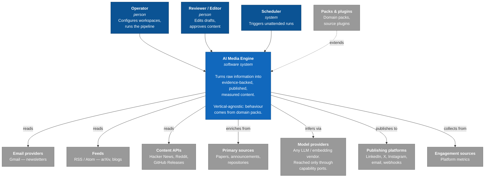
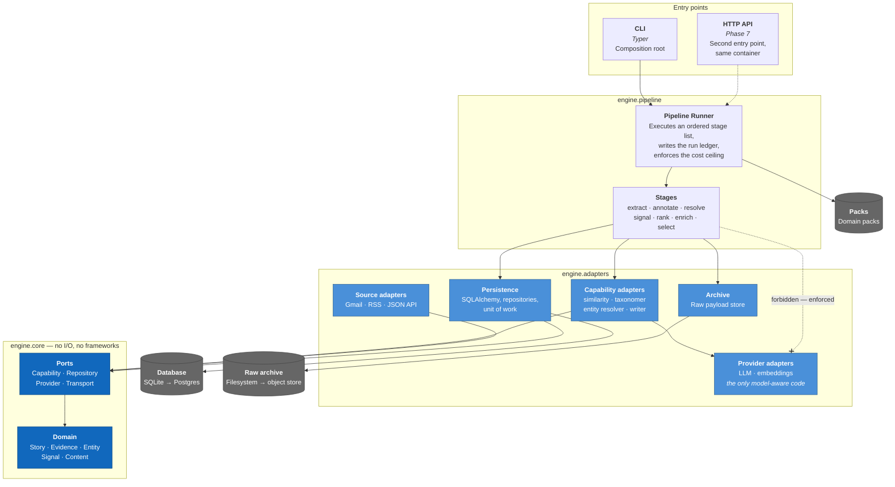
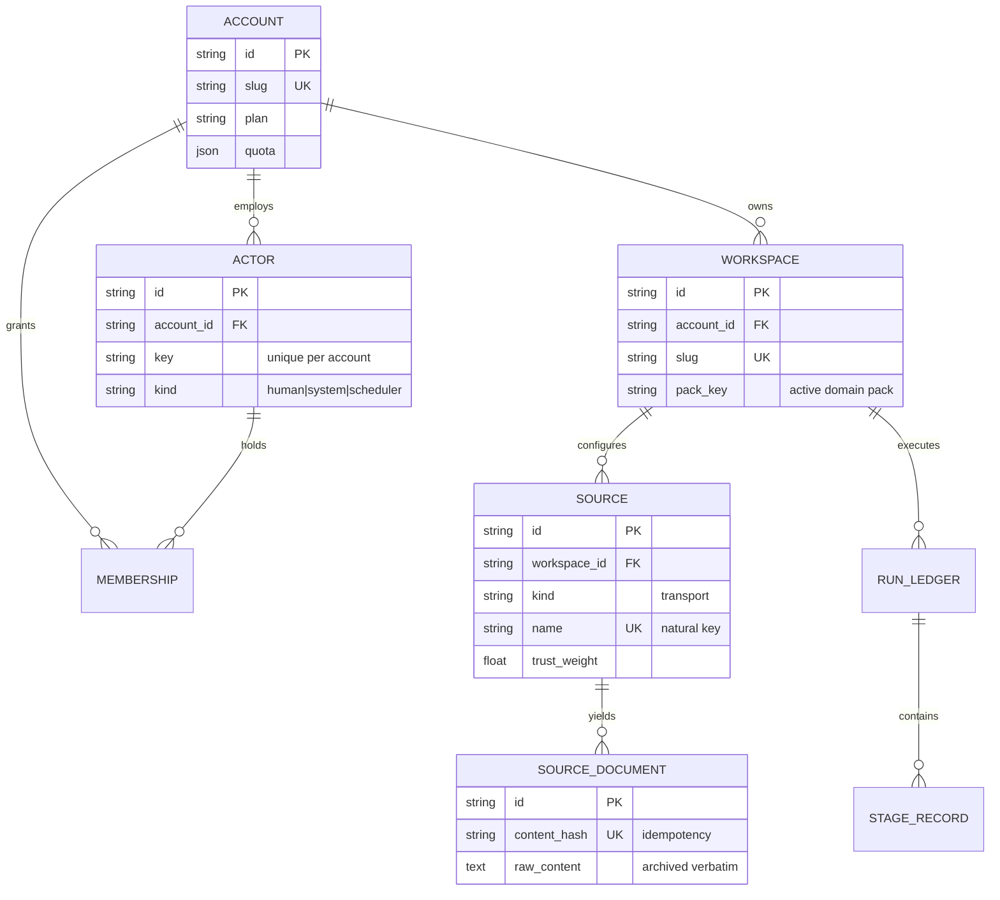
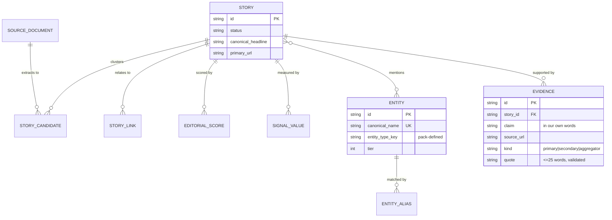
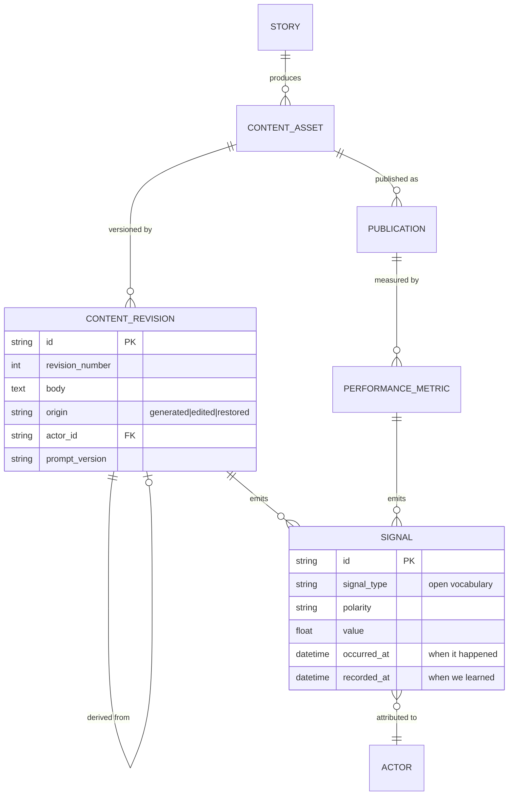
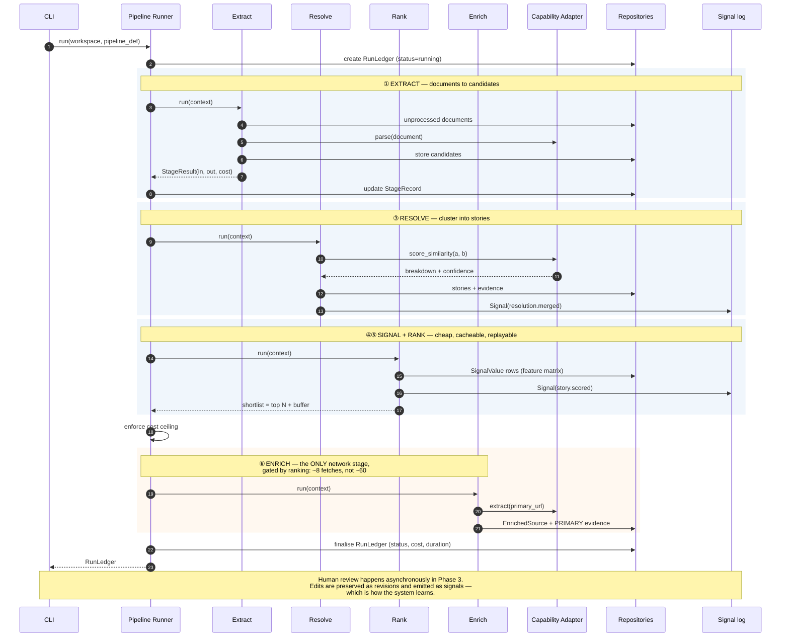

# Architecture Diagrams

The architecture as built and as planned through Phase 2. Four views: two C4
levels, the domain model, and the runtime sequence.

Entities shown are either implemented or scheduled in the current roadmap.
Ideas considered and deferred are recorded in `FUTURE_IDEAS.md` and deliberately
do **not** appear here.

Diagrams are Mermaid and render natively on GitHub.

---

## 1. Context (C4 Level 1)

Who uses the engine and what it talks to. Note that the engine has **no
subject-matter knowledge of its own** — that arrives as a domain pack.

---

## 2. Containers (C4 Level 2)

Dependencies point inward only, and the rule is machine-enforced by
`lint-imports`. The dashed line is the constraint that keeps the system
provider-independent: **stages may not reach a model provider directly.**

---

## 3. Domain model

Three views of one model. Split for readability, not because the boundaries are
hard.

### 3a. Tenancy, ingestion and orchestration

### 3b. Intelligence

Phase 2 builds this view. `STORY` is the deduplicated unit; `EVIDENCE` is the
provenance chain that lets any published claim be traced to a primary source.

### 3c. Content and learning

The revision chain preserves what the model wrote alongside what the human
published. The signal log records outcomes. Both are append-only.

---

## 4. Pipeline sequence

One daily run. Note three things: the cost ceiling is checked after every stage,
enrichment happens **after** ranking so only the shortlist is fetched, and every
stage emits signals as it goes.

---

## Reading the diagrams together

| Question | Diagram |
|---|---|
| Who uses this and what does it touch? | 1 |
| How is the code layered, and what may not import what? | 2 |
| What is remembered, and what is recomputable? | 3a–3c |
| What happens on a run, and where is money spent? | 4 |

The load-bearing constraints, visible across all four:

1. **The domain core has no I/O** (2) — enforced by `lint-imports`.
2. **Stages never touch a model provider** (2) — capability adapters only.
3. **Enrichment follows ranking** (4) — cost is gated by editorial judgment.
4. **Content revisions and signals are append-only** (3c) — what the model wrote
   is never overwritten by what the human published.
